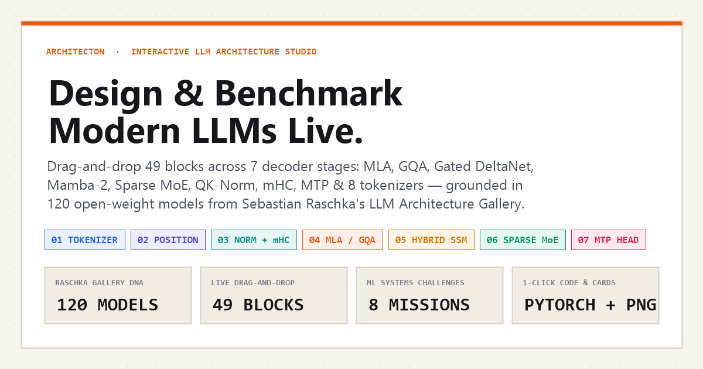
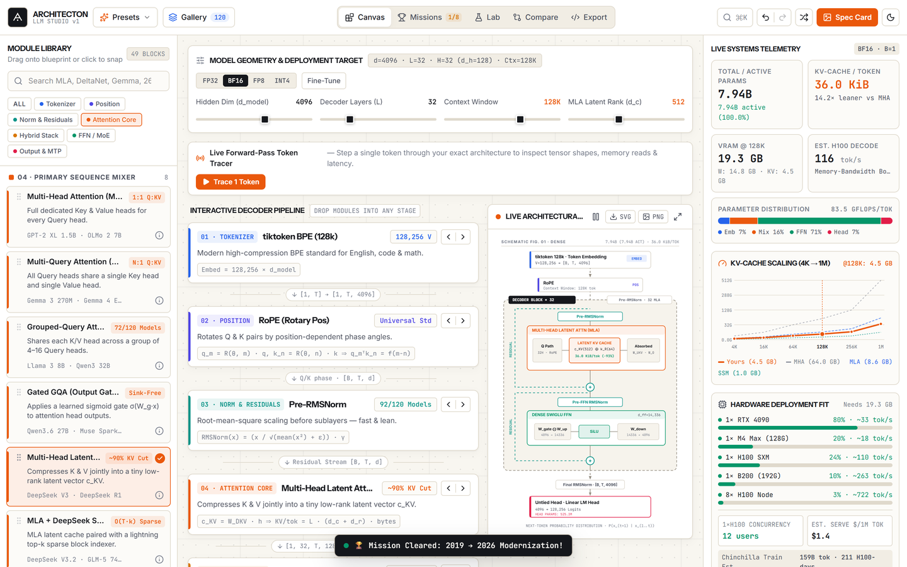
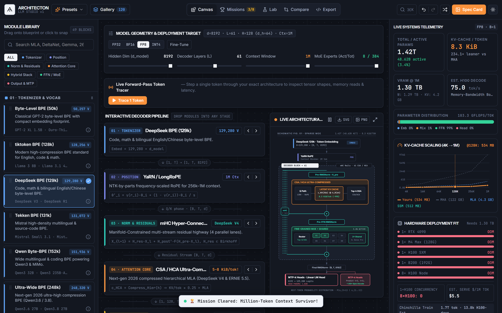
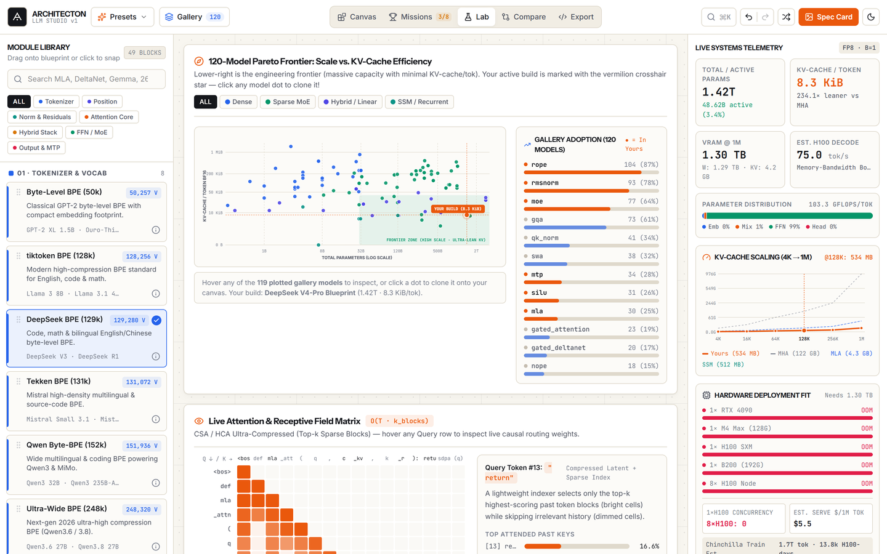
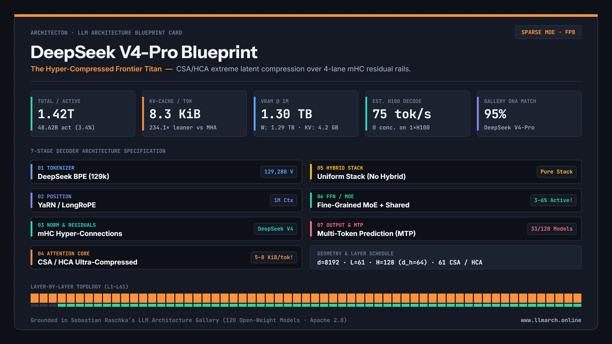
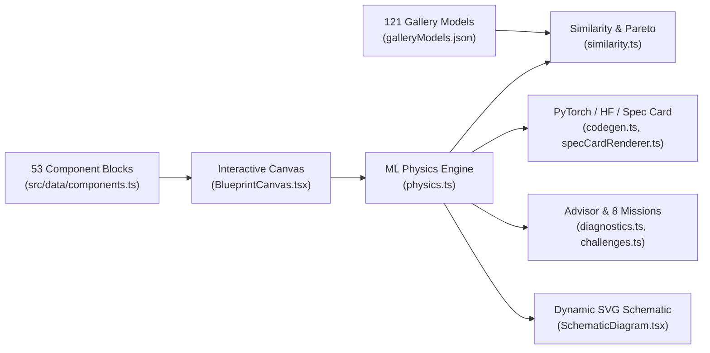

<div align="center">

<br />



<br />

# ARCHITECTON

### Interactive Drag-and-Drop LLM Architecture Studio

**Combine 53 real architectural blocks across 7 decoder stages — GLM-5.4 Sandwich Loop MoE, MLA/DSA + Cross-Loop Hybrid KV, Gated Progressive Loops (`β_k`), GQA, Gated DeltaNet, Mamba-2, Sparse & Latent MoE, QK-Norm, mHC Hyper-Connections, MTP heads & 9 tokenizers — and watch real KV-cache, VRAM, GPU fit, schematic diagrams, and PyTorch code react live.**

Grounded in **121 open-weight models** — all 120 models from [Sebastian Raschka's LLM Architecture Gallery](https://sebastianraschka.com/llm-architecture-gallery/) plus **Z.ai's GLM-5.4 Loop Transformer** (`26 + 28×2 + 24 = 106 eff. layers`).

<br />

[](https://llmarch.online)
[](https://github.com/AKMessi/llm-arch/stargazers)
[](./LICENSE)
[](https://sebastianraschka.com/llm-architecture-gallery/)

<p>
  <a href="#-try-these-5-second-experiments">5-Second Experiments</a> &nbsp;·&nbsp;
  <a href="#-visual-tour">Visual Tour</a> &nbsp;·&nbsp;
  <a href="#-53-modular-blocks-across-7-stages">53 Blocks</a> &nbsp;·&nbsp;
  <a href="#-real-ml-systems-physics">Physics Engine</a> &nbsp;·&nbsp;
  <a href="#-quick-start">Quick Start</a> &nbsp;·&nbsp;
  <a href="#-contributing">Contributing</a>
</p>

</div>

---

## Why ARCHITECTON?

Static LLM architecture diagrams show you *what* a model looks like. They don't let you feel *why* modern models made those trade-offs.

- What actually happens to KV-cache and single-GPU fit when you drop **DeepSeek's Multi-Head Latent Attention (MLA)** into **Llama 3 8B**?
- How flat does the `4K → 1M` memory curve get when you replace 75% of attention layers with **Qwen3.5's 3:1 Gated DeltaNet** or **Nemotron 3's Mamba-2 SSM**?
- How much embedding overhead does **Gemma's 262k SentencePiece vocabulary** cost on a 3B edge model if you forget **Weight-Tying**?

**ARCHITECTON** turns modern open-weight LLM design into a live, tactile, Swiss-blueprint engineering workbench — running **100% client-side in your browser** with zero signup and zero backend.

---

## ⚡ Try These 5-Second Experiments

Open **[llmarch.online](https://llmarch.online)** and try any of these live:

| Experiment | What You Drag / Toggle | Live Result You See Immediately |
| :--- | :--- | :--- |
| **Llama 3 + DeepSeek MLA** | Start on `Llama 3 8B` → drop **MLA** into Stage 04 | KV-cache drops **72%** (`128 → 36.0 KiB/tok`), **1× RTX 4090** flips `OOM → Fits (80%)`, **1× H100 concurrency jumps 4×** (`3 → 12 users`), SVG schematic morphs to `c_KV(512) ⊕ k_R(64)` |
| **Z.ai GLM-5.4 Loop Transformer** | Load `GLM-5.4 (Loop 750B)` from Presets | **Sandwich Loop layout (`26 + 28×2 + 24 = 106 eff. layers`)** in a 78-layer 744B MoE footprint, **`β_k` progressive gates**, **`87.8 KiB/tok` MLA + Pass-2 SWA(1024)** hybrid KV at **1M context**, plus authentic Sandwich Loop PyTorch codegen |
| **Frontier 1M-Context Hybrid** | Load `Qwen3.5 397B` or `Nemotron 3 Super` | **60-layer color-coded hybrid ribbon**, `8–30 KiB/tok` KV-cache, flat `4K → 1M` scaling curve vs. baseline MHA |
| **Zero-KV Infinite Streamer** | Drop **Pure xLSTM / mLSTM** into Stage 05 | KV-cache hits **`0 B/token`**, enabling **400+ concurrent 256K streams** on 1× H100 |
| **Recurrent-Depth Thinker** | Drop **Looped Depth Sharing (`×4`)** into Stage 06 | **128 effective reasoning layers** inside an 8B physical weight footprint |
| **2019 → 2026 Time Machine** | Load `GPT-2 XL (2019)` → follow the **Advisor** & **Mission 03** | Modernize `300 KiB/tok · 1K ctx` step-by-step into a modern `≥128K` architecture |

---

## 🎨 Visual Tour

### 1. Interactive Drag-and-Drop Canvas & Dynamic Schematic (Warm Drafting Paper)
Drag any block from the left Module Library onto its matching stage — hover previews exact `ΔKV` and `ΔActive Params` before you release, while the live SVG schematic, layer ribbon, KV scaling curve, and 120-Model Gallery Match Radar update instantaneously.



### 2. Obsidian Blueprint Dark Mode & DeepSeek V4-Pro (`1.42T · 8.3 KiB/tok · 4-Lane mHC`)
Switch seamlessly between **Archival Drafting Paper** and **Obsidian Blueprint** mode. Inspect cutting-edge 2026 topologies including 4-lane **mHC Hyper-Connections**, **CSA/HCA** ultra-compressed latents, Fine-Grained MoE + Shared Experts, and **MTP-k** speculative heads.



### 3. 120-Model Pareto Frontier & Gallery Adoption Explorer
Every real model from Sebastian Raschka's gallery is plotted on a log-scale **Total Parameters vs. KV-Cache/token** Pareto chart with **your custom build tracked live as a vermilion crosshair star**. Click any dot on the frontier to clone and remix that real model onto your canvas.



### 4. One-Click Shareable 2× Retina Architecture Spec Card PNG
Export publication-grade `2400×1350px` Poster Cards (Paper or Obsidian style) with auto-classified architectural archetypes, 5 hero telemetry KPIs, all 7 stage specs, miniature layer topology ribbon, and Gallery DNA match %.



---

## 🧩 53 Modular Blocks Across 7 Stages

| Stage | Available Draggable Modules | Representative Models |
| :--- | :--- | :--- |
| **01 · Tokenizer & Vocab** | Compact 32k · GPT-2 BPE 50k · tiktoken 128k · DeepSeek BPE 129k · Tekken 131k · Qwen BPE 152k · **GLM-5 BPE 155k** · Ultra-Wide BPE 248k · SentencePiece 262k | GPT-2, Llama 3, DeepSeek V3/V4, Mistral Small 4, Qwen3.5/3.8, GLM-5.4, Gemma 3/4 |
| **02 · Position & Embeddings** | Learned AbsPos · RoPE · YaRN / LongRoPE · Partial RoPE (`p-RoPE`) · Local-RoPE + Global-NoPE · Pure NoPE · RoPE + Per-Layer Embeddings (`PLE`) | Llama 3, Gemma 4, SmolLM3, Muse Spark, Ember-1, Gemma 4 E2B/E4B |
| **03 · Norm & Residual Flow** | Pre-LayerNorm · Pre-RMSNorm · Pre-RMSNorm + QK-Norm · Peri-Norm (`4× RMSNorm`) · Post-RMSNorm + QK-Norm · **mHC 4-Lane Hyper-Connections** · Attention Residuals + Gate · **Gated Progressive Loop (`β_k`)** | GPT-2, Llama 3, Qwen3, Gemma 3/4, OLMo 2/3, DeepSeek V4, ERNIE 5.5, GLM-5.4 |
| **04 · Primary Sequence Mixer** | MHA · MQA · GQA · Sink-Free Gated GQA (`σ`) · **MLA** · **MLA + DeepSeek Sparse Attention (DSA)** · **MLA/DSA + Cross-Loop Hybrid KV (`IndexShare` + `SWA 1024`)** · **CSA / HCA** · Cross-Layer KV Sharing | OLMo 2, Llama 3, Qwen3.6, DeepSeek V3/V3.2/V4, GLM-5/5.4, Gemma 4 E-Series |
| **05 · Hybrid Layer Interleave** | Uniform Stack · Sliding-Window / Global (`1:1`–`6:1`) · **Gated DeltaNet** · **Kimi Delta Attention (KDA)** · **Mamba-2 SSM** · LIV ShortConv · **Pure xLSTM / mLSTM** | Gemma 3/4, OLMo 3, Qwen3.5/3.8, Ember-1, Nemotron 3, Liquid LFM2, xLSTM 7B |
| **06 · Feed-Forward / MoE** | Classic GELU MLP · Dense SwiGLU · Dense GeGLU · Sparse MoE (Top-k) · Fine-Grained MoE + Shared Experts + Dense Prefix · **Latent MoE** · **Looped Depth Sharing (`×K`)** · **Looped Sparse MoE (Sandwich `×K`)** | GPT-2, Llama 3, Gemma 3, Qwen3-MoE, DeepSeek V3, Nemotron 3.5, Dory 1.0, Ouro, **GLM-5.4** |
| **07 · LM Head & Objectives** | Untied Linear LM Head · Weight-Tied Embeddings · **Multi-Token Prediction (`MTP-k`)** · Tied + Logit Soft-Cap · MTP + Learned Attention Sinks | Llama 3, Gemma 3, DeepSeek V3/R1/V4, GLM-5.4, GPT-OSS, Reflection Beam |

---

## 🎯 Additional Interactive Studio Modules

- **Live Token Forward-Pass Tracer:** Step a single token (`"attention"`, `#48291`) through Stages `1 → 7` with synchronized pipeline & schematic highlights, exact tensor shapes, memory reads (MB/GB), and microsecond stage latency shares.
- **8 ML Systems Design Missions:** Live-evaluated engineering challenges (*Single RTX 4090 Monster*, *Million-Token Context Survivor*, *2019 → 2026 Modernization*, *5%-Active Frontier Titan*, *Sink-Free Deep Dense*, *262k Polyglot Edge Diet*, *Recurrent-Depth Reasoning*, *Zero-KV Infinite Streamer*) with a pinnable live HUD and persistent local progress.
- **Attention Matrix & Live Tokenizer Sandbox:** Hoverable `16×16` causal / SWA / Top-k DSA / DeltaNet / Mamba-2 / Attention-Sink heatmap + live head-to-head tokenizer compression comparator across code, prose, multilingual math, and JSON.
- **Diff & Surgical Cherry-Pick Arena:** Benchmark your active Blueprint A against any of the 13 presets, all 121 gallery models, or a local snapshot — and cherry-pick individual stages from Model B → A in one click.
- **Export Suite + `⌘K` Command Palette + Local Vault:** Generate runnable PyTorch `nn.Module` (`model.py`), Hugging Face `config.json`, SVG/PNG schematics, 2× Retina Spec Cards, and URL-hash shareable blueprints (`#bp=...`). Press **`⌘K` / `Ctrl+K`** anywhere to jump to any of 53 blocks, 121 models, or 8 missions.

---

## 🔬 Real ML Systems Physics

Every metric in the right Telemetry Dock is computed analytically from your equipped blocks and dimensions (`d_model`, `n_layers`, `n_heads`, `n_kv_heads`, `d_ff`, `n_experts`, `top_k`, `kv_lora_rank`, `swa_window`, `hybrid_ratio`, `loop_passes`, `context_length`, `precision`):

- **KV-Cache per Token (BF16):**
  - MHA / GQA / MQA: `2 · L_attn · n_kv_heads · d_head · 2 bytes`
  - MLA: `L_attn · (d_c + d_r) · 2 bytes`
  - Sliding-Window layers cap total KV growth at `min(T, W)` tokens
  - Linear / SSM / Recurrent layers (DeltaNet, KDA, Mamba-2, mLSTM) contribute `0 B/tok` growing KV + fixed `O(1)` matrix state
  - Cross-Layer KV Sharing halves upper-layer KV materialization; Looped Depth multiplies KV across passes
- **Total vs. Active Parameters:** Separates input embeddings (+ optional PLE), exact mixer projection weights (QKV / MLA low-rank / SSM / DeltaNet), dense prefix vs. sparse routed + shared experts (or Latent MoE), norms/mHC, and untied vs. weight-tied LM head + MTP heads.
- **Hardware Fit, Concurrency & Economics:** Computes total VRAM (`weights + KV + activations + recurrent state`) across `FP32 / BF16 / FP8 / INT4`, roof-line arithmetic intensity (`Memory-Bandwidth Bound` vs. `Compute Bound`), estimated H100/M4 Max tok/s, **max concurrent sequences on `1× H100` & `8× H100`**, estimated serving `$/1M` tokens, and Chinchilla H100 GPU-days.

---

## 🏗️ Codebase Architecture



```text
src/
├── components/
│   ├── BlueprintCanvas.tsx      # 7-stage drop zones, live ΔKV hover previews & geometry sliders
│   ├── ComponentPalette.tsx     # Searchable 53-block library with pointer drag & touch tap
│   ├── SchematicDiagram.tsx     # Dynamic Raschka-style vector SVG blueprint + SVG/PNG export
│   ├── LayerStackStrip.tsx      # Interactive L1..LN layer schedule ribbon (incl. Sandwich Loop)
│   ├── TokenTraceBar.tsx        # 7-step live single-token forward-pass tracer
│   ├── TelemetryDock.tsx        # Live KPIs, 4K->1M KV chart, GPU fit, Advisor & Gallery Radar
│   ├── MissionsView.tsx         # 8 live-evaluated ML systems design missions
│   ├── SimulationLab.tsx        # 16x16 Attention Mask Matrix + Live Tokenizer Sandbox
│   ├── ParetoFrontierChart.tsx  # 121-Model Scale vs. KV-Cache Pareto scatter + adoption bars
│   ├── CompareView.tsx          # Side-by-side benchmark & surgical stage cherry-picking
│   ├── CodeExportView.tsx       # Live PyTorch nn.Module & Hugging Face config.json export
│   ├── SpecCardModal.tsx        # 2x Retina 1200x675 shareable Spec Card PNG studio
│   ├── GalleryModal.tsx         # Filterable 121-model Architecture Gallery explorer
│   └── CommandPalette.tsx       # ⌘K / Ctrl+K instant search across blocks, models & missions
├── data/
│   ├── components.ts            # 53 architectural blocks (formulas, pros/tradeoffs, examples)
│   ├── galleryModels.json       # 121 real open-weight models (Raschka Gallery + Z.ai GLM-5.4)
│   ├── presets.ts               # 13 landmark presets + 121-model auto-mapper
│   ├── challenges.ts            # 8 design mission evaluators + architectural archetype classifier
│   └── tokenizerSamples.ts      # Live multi-family BPE / SentencePiece segmentation simulator
└── engine/
    ├── physics.ts               # Exact params, KV-cache, concurrency, economics & 7-step trace
    ├── diagnostics.ts           # Real-time compatibility linter & 1-click fix advisor
    ├── similarity.ts            # Live cosine/Jaccard architectural matcher across 121 models
    ├── codegen.ts               # PyTorch nn.Module, HF config.json & URL hash codec
    └── specCardRenderer.ts      # Offscreen Canvas 2D Retina PNG poster renderer
```

---

## 🚀 Quick Start

**Prerequisites:** Node.js `>= 20`

```bash
# 1. Clone the repository
git clone https://github.com/AKMessi/llm-arch.git
cd llm-arch

# 2. Install dependencies
npm install

# 3. Start local dev server
npm run dev
```

Build & preview production bundle:

```bash
npm run build
npm run preview
```

### Keyboard Shortcuts
- **`⌘K` / `Ctrl+K`** — Open Command Palette (search all 53 blocks, 121 models & 8 missions)
- **`Ctrl+Z` / `⌘Z`** — Undo architecture change
- **`Ctrl+Y` / `⌘⇧Z`** — Redo architecture change

---

## 🤝 Contributing

Contributions, bug reports, formula refinements, and new 2026 architecture primitives are very welcome!

Ideas for great PRs:
- Syncing newly released models from [`rasbt/llm-architecture-gallery`](https://github.com/rasbt/llm-architecture-gallery) into `src/data/galleryModels.json`
- Adding new sequence mixers, MoE routing schemes, or quantization formats (e.g., NVFP4 / MXFP4)
- Adding new GPU deployment targets (B200 NVL72, M4 Ultra, AMD MI355X, TPU v6e)
- Designing new ML Systems Design Missions in `src/data/challenges.ts`

---

## 👤 Created By

**Aaryan Kakad**
- Personal Website: [aaryan-kakad.github.io](https://aaryan-kakad.github.io)
- X: [@aaryan_kakad](https://x.com/aaryan_kakad)
- LinkedIn: [linkedin.com/in/aaryankakad](https://linkedin.com/in/aaryankakad)
- GitHub: [@AKMessi](https://github.com/AKMessi)

---

## 📜 Attribution & License

- **Codebase:** Licensed under the **[MIT License](./LICENSE)** (`Copyright (c) 2026 Aaryan Kakad`).
- **Model Catalog Dataset:** `src/data/galleryModels.json` is derived from [**Sebastian Raschka's LLM Architecture Gallery**](https://github.com/rasbt/llm-architecture-gallery) (`models.yml`) under the **Apache License 2.0**. Full attribution and modification notes are preserved in [THIRD_PARTY_NOTICES.md](./THIRD_PARTY_NOTICES.md).

<div align="center">
  <br />
  <strong>If ARCHITECTON helped you understand modern LLM architectures, consider dropping a ⭐ on the repo!</strong>
  <br /><br />
  <a href="https://llmarch.online"><strong>Try ARCHITECTON live at llmarch.online →</strong></a>
</div>
